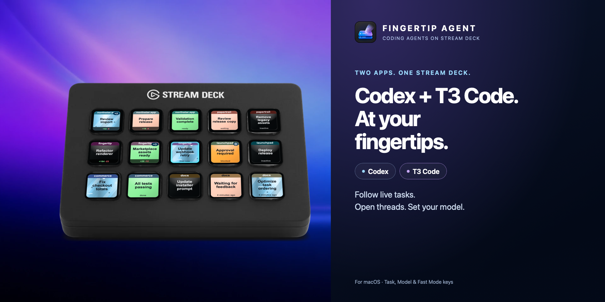
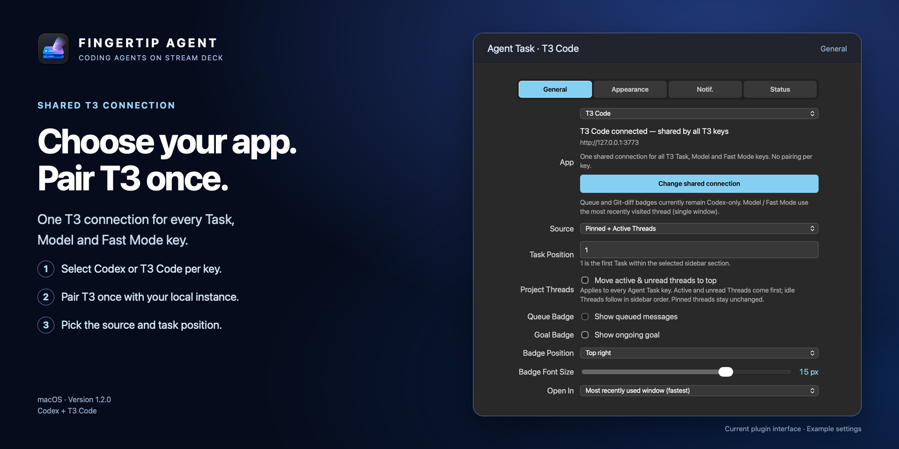
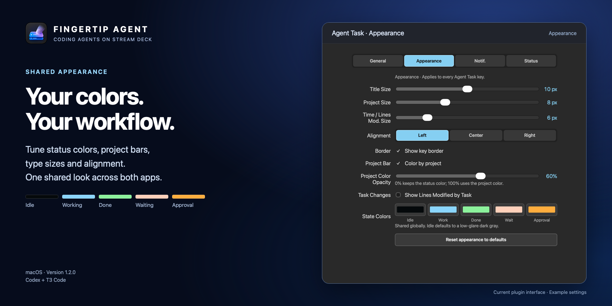
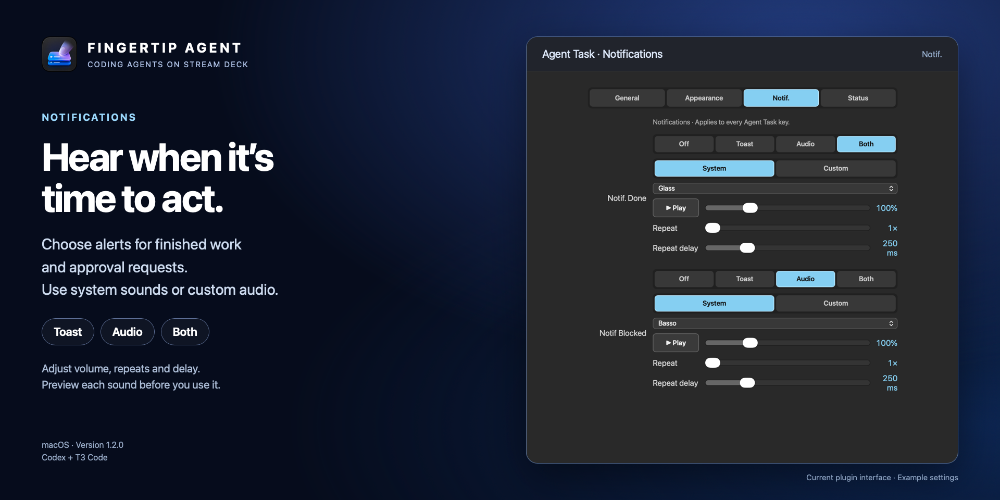
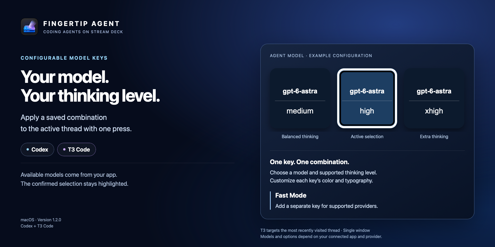

# Fingertip Agent

Fingertip Agent brings Codex and T3 Code to Stream Deck. Follow live task status,
open the matching thread, and apply a model and thinking level with one key press.
Choose the app per key; one T3 pairing is shared by every T3 key.

[](https://marketplace.elgato.com/product/fingertip-agent-eb6fc4f2-5c44-4d98-a825-4e7bb97d1ccd)

## Features

- Codex / ChatGPT and T3 Code on the same Stream Deck, with an app selection
  for Task, Model and Fast Mode keys. T3 uses one shared connection across profiles.
- Live keys for Idle, Working, Done, Waiting, and Approval Required states.
- Animated working and transition feedback, with configurable shared state
  colors, typography, alignment, and borders.
- Project-colored title bars with deterministic shades per project, adjustable
  opacity for blending with the current status color, and automatic
  contrast-aware black or white text.
- Project bars scale with the project-name font and keep the title vertically
  centered with balanced padding.
- Separate `Pinned + Projects` and `Tasks` sources that follow ChatGPT's
  sidebar order, including custom sections and the unified project/chat order.
- One-key navigation to the exact matching Codex task, with a choice of the
  last-active, leftmost, or rightmost ChatGPT window. Active tasks can open a
  fresh ChatGPT conversation when needed.
- Configurable Agent Model keys apply a chosen model and thinking level to the
  active thread. Models and their supported thinking levels are discovered from
  the installed app, including newly available models without a plugin update.
  Each key has its own background color, font sizes, and text alignment.
- A standalone Fast Mode key toggles the active thread's service tier where
  supported by the selected app and provider.
- Single press opens a task, double press highlights it, and long press marks
  it unread.
- Optional task-owned line-change statistics and queue badges for Codex,
  plus ongoing-goal badges with configurable placement and size.
- Shared settings organized into General, Appearance, Notifications, and
  Status tabs.
- Independent notifications when a task enters Done or Approval Required:
  `Off`, `Toast`, `Audio`, or `Both`. Done notifications are suppressed while
  the task has an active Goal, including when the Goal badge is hidden.
- macOS system-sound presets or a custom audio file for each transition, with
  a test-play button, independent volume controls, repeat counts, and repeat
  delays.









Native Toast notifications follow the notification style configured in macOS:
Temporary notifications disappear automatically, while Persistent
notifications remain until dismissed. Audio files are copied locally; accepted
formats are AAC, AIFF, AU, CAF, M4A, MP3, MP4, and WAV up to 25 MB.

## Requirements

- macOS 13 or newer
- Stream Deck 7.1 or newer
- ChatGPT / Codex for macOS or a local T3 Code instance with orchestration protocol 2
- Node.js 24 for development or manual installation

## Install

[Get Fingertip Agent from the Elgato Marketplace](https://marketplace.elgato.com/product/fingertip-agent-eb6fc4f2-5c44-4d98-a825-4e7bb97d1ccd),
or give your coding agent this prompt from the repository directory:

> Install Fingertip Agent on this Mac. First verify the requirements above. Then run
> `npm ci`, `npm run check`, and `npm run build`. Validate
> `com.lukas-bhm.fingertip.sdPlugin` with the Stream Deck CLI, link that plugin
> directory into Stream Deck, and restart the plugin. Do not modify the source.
> Tell me about any failed check or macOS permission prompt.

## Settings

Add or select an **Agent Task** key in Stream Deck and choose its app:

- **General** selects the sidebar source, one-based task position, badges, and
  target ChatGPT window, including the active-task conversation behavior. An
  optional thread ordering moves active and unread Threads to the top while
  keeping pinned threads unchanged.
- **Appearance** controls shared key colors, fonts, alignment, borders,
  deterministic project bar colors, project-color opacity, and line-change
  statistics.
- **Notif.** configures Done and Approval Required notifications independently.
  Audio and Both modes expose the sound source, system preset or custom-file
  picker, test-play control, volume, repeat count, and repeat delay.
- **Status** shows the current key preview, connection diagnostics, component
  versions, and a manual reconnect action.

Appearance and notification preferences are global and apply to every Agent
Task key. Source and task position remain specific to each key.

Add an **Agent Model** key and choose a model and thinking level from the
**General** dropdowns. The list comes from the selected app and
refreshes automatically; **Status → Refresh models** also reloads it on demand.
Changing models selects that model's advertised default thinking level.
Saved selections remain intact when the app is offline or a model becomes
unavailable. Unsupported combinations show a warning and are not applied.

**Appearance** configures that key's background color, separate model and
thinking font sizes, and left, center, or right alignment. These preferences
are independent from the shared Agent Task appearance settings. The key shows
the selected model on its first line and the thinking level on its second.
A bright border marks keys whose model and thinking level match the active
thread's confirmed settings. It follows thread and model changes automatically;
unknown or stale settings and disconnected sessions have no active border.

Press the key to update the currently active existing thread for its next turn.
No prompt is sent. A success indication requires the app to acknowledge the
request and report the matching settings through its live stream. Open an
existing thread first; a new empty composer has no thread to receive settings.
Add **Fast Mode** as a separate key if needed.

The old Model Selector and its bundled XL profile have been removed. Replace
an existing Model Selector launcher with an Agent Model key; no XL-specific
layout or profile installation is required.

## T3 Code

Task, Model and Fast Mode keys now have an **App** selection. Existing keys
continue to use Codex. Select **T3 Code** in General on a Task or Model key,
create a pairing link in T3 Code's Sharing & access settings (Connections in older versions), paste it into
**T3 pairing link**, and click **Connect all T3 keys**. For a desktop link such as
`t3code://app/pair#token=…`, also enter the HTTP address displayed under
**T3 Settings → Sharing & access → Version** into **T3 server address**. The port
may vary between installations; desktop links do not contain it. HTTP pairing
links already contain the server address. The connection is shared
by all T3 keys across profiles and survives plugin restarts. Once configured,
each inspector shows the shared status and server address; pairing is hidden
behind **Change shared connection**. Additional keys only need **App → T3 Code**,
not another pairing link. A Fast Mode key selects its app in its own inspector.

Fingertip uses T3 orchestration protocol 2 over authenticated HTTP and
WebSocket. Pairing requests `orchestration:read` and `orchestration:operate`;
the latter enables model changes and marking threads unread. The session is
stored in `~/.config/fingertip/t3-session.json` with owner-only file permissions,
not in exported Stream Deck profiles. Pair again if access expires or is
revoked, or to switch servers. Local HTTP and remote HTTPS origins are accepted.

T3 task keys show pinned and active top-level threads, or just unpinned active
threads. Archived, settled, snoozed, subagent and side-chat threads are omitted. Pinned
threads keep their pin order, followed by the inbox (newest completion or return
first), then the Working shelf in send order. This follows T3's Working shelf
layout; other sidebar grouping preferences are not mirrored. Press to
open the thread, double press to highlight it, and hold to mark it unread.
Status colors, animations, project labels, Goal badges and notifications use
the existing shared appearance settings. Queue and Git-diff badges currently
remain Codex-only, and their controls are disabled while configuring a T3 key.

Model and Fast Mode keys target the eligible thread with the greatest
`lastVisitedAt`. This deliberately assumes one window; multi-window focus
tracking is not implemented. With no visited thread, the keys report failure
instead of guessing. Models and reasoning choices come from T3's provider
catalog. Fast Mode is enabled only when the selected model advertises a
supported Fast Mode or priority service-tier option. Writes require both a
successful command and matching server readback before reporting success.

On disconnect, existing task images become stale/offline and mutations are
disabled. Reconnection replaces the thread list from a fresh snapshot without
replaying completion notifications. No agent is launched to read task status.

## Development

```sh
npm ci
npm run check
npm run build
npx streamdeck validate com.lukas-bhm.fingertip.sdPlugin
npx streamdeck pack com.lukas-bhm.fingertip.sdPlugin --output dist
```

Use `npm run reload` to build and restart the linked plugin during local
development.

Bundle discovery supports both the original Codex executable and the signed
CLI nested inside current ChatGPT releases. Catalog initialization allows up
to 30 seconds, while regular requests keep their 5-second deadline. Reconnects
wait for the previous catalog process to stop before starting another one.
Optional history requests that exceed the 16 MiB response limit omit change
statistics for that task while keeping the catalog connection available.

Model discovery shares the existing catalog connection. Requests are queued
and serialized so model refreshes cannot interrupt task or history queries.
The desktop adapter supports current settings, read-state, and queue protocols,
with legacy settings fallback for older app versions.
Current read-state v3 requires the app's account and execution-host context.
Until this connection observes a local read-state event, marking a task unread
is unavailable; the plugin does not guess that context. Model changes are
independent of this restriction.

Read-state recovery also observes `electron-thread-read-state-v1` through the
existing global-state watcher and catalog refresh. In ChatGPT/Codex
26.1016.51333, a read/unread change can persist without a desktop IPC broadcast,
and a fresh owner snapshot can contain the new flag at the same stream revision.
Fingertip therefore uses per-thread, account/host-sensitive change tokens only to
request a fresh snapshot for affected subscriptions, and accepts updated read
state at an unchanged revision. Persisted lists are never used directly as the
active account's read state. A thread read immediately while open can leave the
persisted list unchanged and clear its owner state without broadcasting patches.
The regular catalog refresh therefore also checks each new Done owner/revision
once. A same-revision snapshot settles the key back to Idle if already read;
genuinely unread threads stay Done without repeatedly fetching their snapshots.

## Version 1.2.0

- Added T3 Code support for Task, Model and Fast Mode keys alongside Codex.
- Pair T3 once for all keys and profiles; existing Codex keys retain their settings.
- Show live T3 status and open the matching thread. Model and Fast Mode keys target the most recently visited thread (single window).
- Match T3's inbox and Working shelf order: newly completed tasks move ahead of running tasks, while pinned threads keep their order.
- Fixed direct typing in Task Position and preserved live task state during T3 repository-enrichment updates.
- Refreshed Marketplace artwork and setup instructions for both apps.

## Version 1.1.3

- Fixed task keys staying green after a thread has already been read in Codex, including replies read immediately while the thread is open.
- Recover missed read-state updates through targeted status refreshes, while keeping genuinely unread threads green.
- Preserve read-state events received before a thread finishes loading.

## Version 1.1.2

- Replaced the bundled Model Selector with configurable Codex Model keys. Models and supported thinking levels are discovered dynamically from the installed app.
- Added per-key background color, model and thinking font sizes, and text alignment. A live border highlights keys matching the active thread.
- Made Fast Mode available as a standalone action.
- Updated desktop integration for current model settings, read-state, and task queue protocols. Model changes are confirmed through the live settings stream.
- Restored live task lists and status updates with current ChatGPT for macOS releases, with more reliable startup and reconnection.
- Updated task ordering for custom sidebar sections and the unified project/chat order.
- Improved handling of oversized task histories and optional goal lookup errors. Change statistics are skipped for histories that exceed the response limit.
- Suppressed Done notifications while an active Goal continues, even when its badge is hidden, and prevented delayed alerts for outdated task states.
- Fixed outdated connection diagnostics in settings.

Upgrade note: Replace existing Model Selector launcher and profile keys with Codex Model keys. Model keys apply to the active existing thread; open a thread before using them. Empty new composers are no longer supported for model selection.

## Version 1.1.1

- Added Astra 6 above Sol with five monochrome stellar key images.
- Versioned selector layouts by content so existing Model Selector keys open
  the current layout after a plugin update, independently on each Stream Deck.
- Kept existing launcher action IDs and settings compatible with previous releases.
- Documented Elgato's profile-installation confirmation when opening an updated layout.

## Version 1.1.0

- Added a bundled Stream Deck XL Model Selector with Sol, Terra, and Luna
  across Light, Medium, High, Extra High, and Max thinking levels.
- Highlighted the active model combination and applied selections directly to
  the visible ChatGPT task or to a new Composer before its first prompt.
- Added a live Fast Mode key that follows the targeted task and toggles its
  service tier without leaving the selector profile.

## Version 1.0.5

- Restored reliable live status tracking after ChatGPT IPC disconnects with
  fast, bounded automatic reconnects.
- Made active and unread Thread ordering consistent across every Task key,
  including migration of the previous per-key preference.

## Version 1.0.4

- Compatibility with new ChatGPT version (`.codex-global-state.json` size
  increase).

## Version 1.0.3

- Added deterministic project-colored title bars with configurable opacity,
  dynamic status-color mixing, and contrast-aware text.
- Made project-bar height follow the project-name font size and vertically
  centered the title with balanced padding.
- Added single-, double-, and long-press task gestures for opening,
  highlighting, and marking tasks unread.
- Added repeat count and delay controls for Done and Approval Required audio
  notifications.
- Updated the release metadata and documentation for 1.0.3.

## Version 1.0.2

- Added tabbed settings for a roomier Property Inspector.
- Added independent Done and Approval Required notifications.
- Added Toast, Audio, and combined Both notification modes.
- Added macOS system sounds, custom audio import, test playback, and volume.
- Added shared appearance controls, task change statistics, and queue/goal
  badges.

## Version 1.0.1

- Published the first Fingertip Agent release for Stream Deck.
- Added live Codex task status, sidebar-based task selection, direct task
  navigation, and configurable key appearance.

## Compatibility and privacy

Task metadata, appearance settings, and custom audio stay on the Mac.
Fingertip Agent uses ChatGPT's private, unsupported desktop IPC protocol. A future
ChatGPT update may require a compatibility update.

## License

[MIT](LICENSE)
